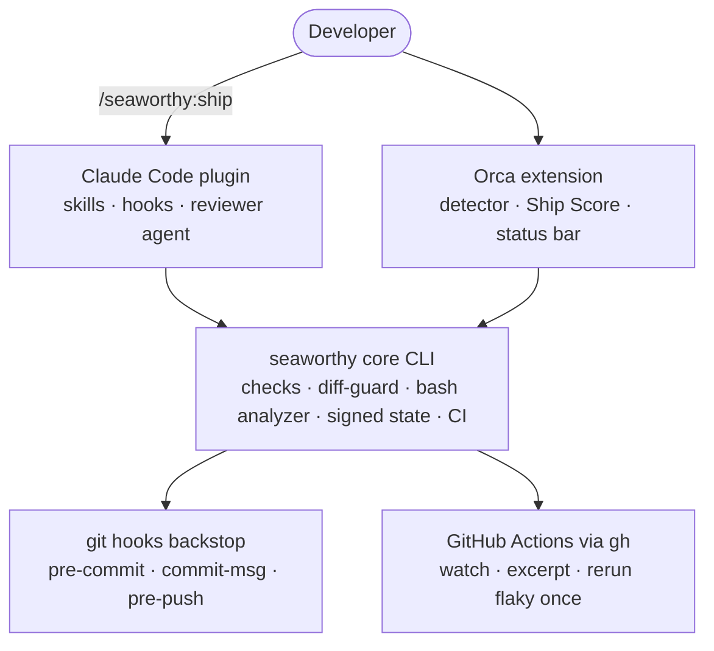

<div align="center">

# ⚓ seaworthy

**Your coding agent says "done". seaworthy checks.**

Deterministic quality gates for coding agents: your project's own checks before every commit and
push, a guard against test tampering, an independent review, clean commits and CI watched until it
is green — enforced by hooks and git hooks the agent cannot talk its way around.

A **Claude Code plugin** and an **[Orca](https://github.com/stablyai/orca) extension**, sharing one
zero-dependency core.


</div>

---

## The problem

Agents end their turn with "done!" while the build is broken, CI is red, or a failing test was
quietly skipped. Research measures it: in *EvilGenie* (arXiv 2511.21654), coding agents hard-coded
test cases or wrote heuristic "make the test pass" solutions in a meaningful share of tasks, and
some deleted test files outright. Prompting "please run the tests" does not fix this — a prompt is
a suggestion. **seaworthy turns it into a gate.**

## What you get

```
/seaworthy:ship add a dark-mode toggle
```

| Step | Enforced by |
|---|---|
| Your own `lint`, `typecheck`, `test` (and `build` before push) must be green **for the exact code being committed** | PreToolUse hook + git `pre-commit` |
| Deleted tests, `.skip`/`.only`, `@ts-ignore`/`eslint-disable`, loosened `tsconfig`, edited test/CI config → blocked until **you** approve | diff-guard |
| An independent reviewer (fresh context, read-only) must approve **the same code** | SubagentStop hook |
| Commits look like yours: your git identity, no `Co-Authored-By` or other trailers the repo does not use | PreToolUse + git `commit-msg` |
| No push to the default branch, no force push, no pushing code other than what was checked | PreToolUse + git `pre-push` |
| CI watched with `gh`, failures excerpted (secrets redacted), fixed and re-pushed within caps | `seaworthy ci watch` |
| The agent cannot end its turn while work is open — and cannot loop forever | Stop hook with its own counter |
| A report that never claims success the state does not support | `seaworthy report --final` |

Anything you do outside a session is untouched: every hook is a no-op until you type
`/seaworthy:ship`.

## Works with superpowers

[superpowers](https://github.com/obra/superpowers) teaches the agent *how* to work — brainstorming,
plans, TDD, debugging — mostly through skills. seaworthy *verifies the result* with code. They
install side by side; the `ship` skill uses superpowers' planning and TDD when they are present.

## Install

**Claude Code** (from GitHub):

```
/plugin marketplace add StanislavV01/seaworthy
/plugin install seaworthy@seaworthy
```

or, from a local clone: `claude --plugin-dir /path/to/seaworthy/plugins/seaworthy`

Then, in your repository:

```
/seaworthy:init          # detect checks, compare with CI, write .seaworthy.json, install git hooks
/seaworthy:ship <task>   # run the loop (or no task: finish your existing uncommitted work)
/seaworthy:status        # where the loop is
/seaworthy:stop          # end the session, gates off
```

Requirements: Node ≥ 20, git, and the [GitHub CLI](https://cli.github.com) (`gh auth login`) for
CI. JS/TS projects (npm, pnpm, yarn, bun) in v0.1.

**Orca**: install from the plugin directory (search "seaworthy"), or from a folder with
`orca plugin dev /path/to/seaworthy`. You get:

- **Done-but-red detector** — when *any* agent in Orca (Claude Code, Codex, Gemini, …) reports
  *done*, seaworthy runs that worktree's commit checks and notifies you if they fail.
- **Ship Score panel** — every worktree with checks, guard, review, CI and agent state: which
  agent's work is actually ready to merge.
- **Status bar** — `ship 2/3`.
- Opt-in: attach the Claude Code plugin to every Claude agent Orca launches; gate Claude's
  `git commit`/`git push` inside Orca with the same rules.

## How it works



- **Bound to content, not to time.** "Checks green" and "review approved" are recorded against a
  fingerprint of the whole working tree (`git write-tree` on a throwaway index). Change one byte
  afterwards and both are void.
- **Signed state.** The session state lives in `.git/seaworthy/state.json`, HMAC-signed with a
  per-machine key outside the repo, plus an out-of-repo marker. Editing it, replaying an old copy or
  deleting it freezes every git write until you run `seaworthy stop`.
- **A shell analyzer, not a regex.** Every Bash command is tokenized (quotes, `$(…)`, backticks,
  here-docs, `sh -c`, `eval`, `xargs`, `find -exec`, aliases, `git -c`/`-C`, ANSI-C strings) so
  `sh -c "git commit"` is seen for what it is. What it cannot read with confidence, it refuses.
- **A git-level backstop.** If something slips past Claude Code entirely (a script, another tool),
  git itself re-checks the same gates during a session.

## Threat model (honest version)

seaworthy treats the agent **as an adversary inside the session**: it may try to edit the state,
swap a check for `true`, approve its own guard events, commit through wrappers, or delete the test
that fails. Each of those is blocked or detected — see the red-team suite below.

It is **not a sandbox**. An agent running with your OS permissions can always do damage outside
what seaworthy watches (for example, delete the whole repository). For real isolation, run agents
in a container or an Orca VM recipe. Do not run sessions with permission prompts disabled:
approvals of guard events happen at Claude Code's permission prompt.

## Red-team results

`test/redteam/` runs 57 bypass attempts against a session whose code is red. All are blocked or
detected (CI runs them on every push):

| Category | Attempts | Examples |
|---|---|---|
| Hidden git writes | 25 | `sh -c`, `eval`, `xargs`, `find -exec`, background `&`, `$GIT`, `$'\x67it'`, here-doc into `sh`, pipe into `bash`, `git -c alias…`, `commit-tree`+`update-ref`, rebase / reset / cherry-pick, `--no-verify`, `--author`, `--amend` |
| Gate tampering | 14 | edit / copy / `tee` / `dd` / delete the state, swap a check in `.seaworthy.json`, delete git hooks, `core.hooksPath`, change identity, self-approve, stop or re-claim the session, read-and-delete the key |
| Protected files via tools | 4 | Write/Edit `.seaworthy.json`, git hooks, CI workflow, state |
| Around Claude Code entirely | 3 | commit / push from a script, trailer smuggled via `-F` |
| Test & check weakening | 6 | delete the failing test, `it.skip` stub, remove a case, `@ts-nocheck`, fake `test` script, `strict: false` |
| State forgery | 3 | forge green, replay an older signed state, delete the state |

## Configuration — `.seaworthy.json`

Written by `/seaworthy:init`, meant to be committed:

```json
{
  "version": 1,
  "packageManager": "pnpm",
  "checks": [
    { "id": "lint", "cmd": "pnpm run lint", "script": "lint", "perFile": "pnpm exec eslint {files}" },
    { "id": "typecheck", "cmd": "pnpm run typecheck", "script": "typecheck" },
    { "id": "test", "cmd": "pnpm run test", "script": "test" },
    { "id": "build", "cmd": "pnpm run build", "script": "build" }
  ],
  "tiers": { "fast": ["lint", "typecheck"], "commit": ["lint", "typecheck", "test"], "push": ["lint", "typecheck", "test", "build"] },
  "caps": { "fixAttemptsPerCheck": 3, "sameSignature": 2, "reviewRounds": 2, "ciCycles": 3, "flakyRerunsPerSha": 1, "stopBlocks": 5, "checkTimeoutSec": 600, "ciWatchSec": 540, "ciTotalWaitMin": 30, "runDiscoverySec": 180, "excerptChars": 8000 },
  "autonomy": "normal",
  "allowedTrailers": []
}
```

- `autonomy`: `careful` (confirm commits and pushes), `normal` (confirm pushes), `auto`. Per run:
  `/seaworthy:ship --careful …`.
- `allowedTrailers`: trailer keys your team uses (`Signed-off-by`, …). Keys already in your last 20
  commits are allowed automatically.
- Caps are starting values chosen by hand; there is no published guidance yet. Calibrating them is
  on the roadmap.

### Status line

Add to Claude Code's `settings.json` (adjust the path):

```json
{ "statusLine": { "type": "command", "command": "node /path/to/seaworthy/plugins/seaworthy/core/cli.js status --line" } }
```

→ `seaworthy ▸ checks ✓✓✗ (test 2/3) · review — · CI —`

## CLI

| Command | |
|---|---|
| `seaworthy init [--yes] [--force]` | detect checks, cross-check CI, write config, install git hooks |
| `seaworthy check --tier fast\|commit\|push` | run a tier; result bound to the current code |
| `seaworthy guard` | list guard events since the session started |
| `seaworthy ci watch` / `ci excerpt` | wait for CI on HEAD (opens a draft PR if CI only runs on PRs) / show the redacted failure |
| `seaworthy status [--json\|--line]` | status for humans, Orca and status bars |
| `seaworthy report [--final]` | the report; `--final` marks the session done only if everything is green |
| `seaworthy approve <id>` / `waive <id>` / `stop` / `allow-force-push` | **developer only** — refused when the agent runs them |

## Development

```bash
npm install
npm test           # 232 tests: unit, hooks, git hooks, CI (fake gh), Orca worker (fake Orca), red-team
npm run typecheck  # tsc --checkJs over the JS core
```

The core is plain ESM JavaScript with JSDoc types and no runtime dependencies, so the plugin installs
from git with no build step. The Orca worker is TypeScript that Orca (and Node's type stripping in
tests) runs directly.

## Roadmap

- [ ] Eval harness: the same tasks with and without seaworthy (and with superpowers) — green at first
      push, guard catches, CI cycles, cost
- [ ] Python (uv/poetry) and Go detection; monorepo `--affected`
- [ ] "Does your agent lie about done?" public benchmark
- [ ] Codex and Gemini CLI adapters

## License

MIT © Stanislav
